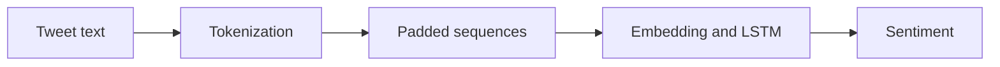

# Airline Sentiment Classification

### LSTM text classification for positive, neutral and negative airline tweets.

**Python · Keras/TensorFlow · LSTM · NLP**

Classifies airline tweets as positive, neutral or negative. The notebook tokenizes the text, pads the sequences, and trains an embedding plus LSTM classifier for the three labels.

## What is included

- Tweet preprocessing and tokenization
- Embedding and LSTM-based classification
- Single-text prediction helper

## How it works

## Running it

Use the [main notebook](../../24_airline_sentiment_lstm.ipynb), which uses a three-class softmax output, sparse categorical cross-entropy and argmax prediction. [sentiment-lstm.ipynb](sentiment-lstm.ipynb) in this folder is an earlier version kept for comparison.

Download the Twitter US Airline Sentiment dataset (Tweets.csv), set its path in the notebook, and install TensorFlow/Keras, pandas and NumPy. The dataset isn't stored here because it contains user and location details.
